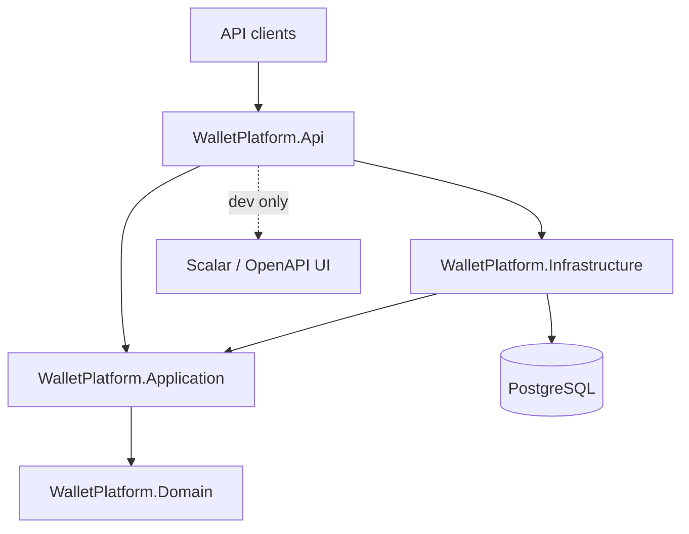

# PayPocket

A fintech-style digital wallet and bill-payment backend built with ASP.NET Core and PostgreSQL.

**Current status: Week 2 — accounts and authentication.** Users can register, log in with a JWT access token and a rotating refresh token, and read their profile and wallet. Balances and the double-entry ledger arrive in Week 3. The Week 1 skeleton (layered solution, database wiring, structured logging, error handling, health checks, tests, CI) is still the foundation everything plugs into.

## Architecture



Dependencies point inward only. `Domain` has no dependencies at all, `Application` knows only `Domain`, `Infrastructure` implements `Application` ports, and `Api` is the composition root. The compiler enforces this through project references.

| Project | Responsibility |
| --- | --- |
| `src/WalletPlatform.Api` | Controllers, middleware, DI composition, `Program.cs` |
| `src/WalletPlatform.Application` | Use cases, interfaces, DTOs, validators |
| `src/WalletPlatform.Domain` | Entities, value objects, business rules |
| `src/WalletPlatform.Infrastructure` | EF Core `WalletDbContext`, migrations, external adapters |
| `tests/WalletPlatform.UnitTests` | Fast, dependency-free tests |
| `tests/WalletPlatform.IntegrationTests` | API tests against a real Postgres in Docker |

## Tech stack

- .NET 10 (LTS) / ASP.NET Core controllers
- EF Core 10 + Npgsql (PostgreSQL 17)
- Serilog (console sink, request logging)
- xUnit, FluentAssertions 6.x, Testcontainers
- Docker Compose, GitHub Actions

## Prerequisites

- [.NET 10 SDK](https://dotnet.microsoft.com/download)
- [Docker Desktop](https://www.docker.com/products/docker-desktop/) (running)
- Optional: `psql` or any Postgres client to inspect the database

## Run locally

```bash
# 1. Create your environment file (never commit it)
cp .env.example .env          # Windows: Copy-Item .env.example .env

# 2. Start PostgreSQL (host port 5434 -> container 5432, see .env)
docker compose up -d
docker compose ps            # wait for STATUS = healthy

# 3. Restore local tools and packages
dotnet tool restore
dotnet restore

# 4. Apply database migrations
dotnet ef database update \
  --project src/WalletPlatform.Infrastructure \
  --startup-project src/WalletPlatform.Api

# 5. Run the API
dotnet run --project src/WalletPlatform.Api
```

The API listens on `http://localhost:5178` (from `Properties/launchSettings.json`).

| Endpoint | Auth | Purpose |
| --- | --- | --- |
| `GET /api/ping` | anonymous | App version and server time (UTC) |
| `POST /api/auth/register` | anonymous | Create a customer account and its wallet |
| `POST /api/auth/login` | anonymous | Exchange credentials for an access + refresh token |
| `POST /api/auth/refresh` | anonymous | Rotate a refresh token for a new token pair |
| `GET /api/users/me` | Bearer | Current user profile and wallet summary |
| `GET /api/admin/users` | Bearer (Admin) | Paged list of users |
| `GET /health/live` | anonymous | Liveness — process is up, no dependencies checked |
| `GET /health/ready` | anonymous | Readiness — verifies PostgreSQL connectivity |
| `GET /openapi/v1.json` | anonymous | OpenAPI document (Development only) |
| `GET /scalar/v1` | anonymous | Scalar API UI (Development only) |

> Port 5434 is the default host port because locally installed PostgreSQL services commonly occupy 5432/5433. Change `POSTGRES_PORT` in `.env` (and the connection string) if you prefer another port.

## Run tests

```bash
dotnet test
```

- Unit tests need nothing beyond the SDK.
- Integration tests use Testcontainers, which starts a disposable `postgres:17-alpine` container — Docker must be running. They do not use the compose database.

## Database migrations

```bash
# Add a migration
dotnet ef migrations add <Name> \
  --project src/WalletPlatform.Infrastructure \
  --startup-project src/WalletPlatform.Api

# Apply pending migrations
dotnet ef database update \
  --project src/WalletPlatform.Infrastructure \
  --startup-project src/WalletPlatform.Api
```

## Configuration

The development connection string lives in `src/WalletPlatform.Api/appsettings.Development.json`. Override it anywhere else via the standard ASP.NET Core environment variable:

```bash
ConnectionStrings__PayPocketDb="Host=...;Port=...;Database=...;Username=...;Password=..."
```

`.env` only feeds Docker Compose; the application never reads it directly.

### Authentication configuration

JWT settings live under the `Jwt` section. The signing key is **never** committed — it is supplied out of band via user-secrets (development) or environment variables (deployment):

```bash
dotnet user-secrets set "Jwt:SigningKey" "$(openssl rand -hex 32)" --project src/WalletPlatform.Api
```

| Key | Default | Notes |
| --- | --- | --- |
| `Jwt:Issuer` | `paypocket-dev` | Validated on token creation and validation |
| `Jwt:Audience` | `paypocket-dev` | Validated on token creation and validation |
| `Jwt:SigningKey` | *(required)* | HMAC-SHA256 key, at least 32 characters |
| `Jwt:AccessTokenMinutes` | `15` | Access token lifetime |
| `Jwt:RefreshTokenDays` | `7` | Refresh token lifetime |

Optionally bootstrap an administrator by setting `SeedAdmin:Email` and `SeedAdmin:Password` (environment variables `SeedAdmin__Email` / `SeedAdmin__Password`). Seeding runs at startup only when both are present, and is skipped if an account with that email already exists.

### Authentication model

- Access tokens are short-lived (15 min) JWTs with `sub`, `email`, `role` and `jti` claims.
- Refresh tokens are 256-bit random values; only their SHA-256 hash is stored. Each use rotates the token, and presenting a revoked token revokes the entire token family.
- Passwords are stored as PBKDF2 hashes via ASP.NET Core Identity's `PasswordHasher<T>` (used standalone, without the rest of Identity). Login enforces a lockout of 5 failed attempts for 15 minutes.
- Login failures return one generic message so the endpoint cannot be used to enumerate accounts.

## CI

`.github/workflows/ci.yml` runs on pushes and pull requests to `main`: restore, build (Release), test, then uploads `.trx` results as an artifact. Testcontainers works out of the box on the Ubuntu runner because Docker is preinstalled.

## Design decisions

See [docs/DECISIONS.md](docs/DECISIONS.md).
