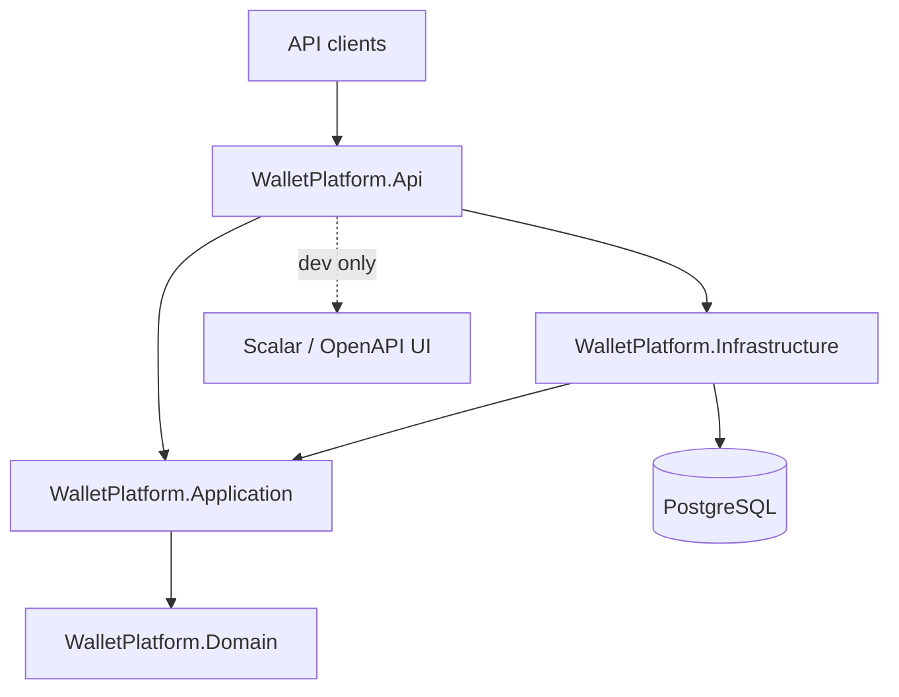

# PayPocket

A fintech-style digital wallet and bill-payment backend built with ASP.NET Core and PostgreSQL.

**Current status: Week 3 — the double-entry ledger.** Building on the Week 2 accounts and authentication, wallet funding now flows through an append-only, double-entry ledger: every movement is a balanced journal entry, balances are derived (never stored), corrections are made with reversals, and an admin endpoint reports a trial balance. Weeks 4–6 will add customer transfers, idempotency and biller payments (see [Known gaps](#known-gaps-weeks-4-6)).

## Architecture



Dependencies point inward only. `Domain` has no dependencies at all, `Application` knows only `Domain`, `Infrastructure` implements `Application` ports, and `Api` is the composition root. The compiler enforces this through project references.

| Project | Responsibility |
| --- | --- |
| `src/WalletPlatform.Api` | Controllers, middleware, DI composition, `Program.cs` |
| `src/WalletPlatform.Application` | Use cases, interfaces, DTOs, validators |
| `src/WalletPlatform.Domain` | Entities, value objects, business rules |
| `src/WalletPlatform.Infrastructure` | EF Core `WalletDbContext`, migrations, external adapters |
| `tests/WalletPlatform.UnitTests` | Fast, dependency-free tests |
| `tests/WalletPlatform.IntegrationTests` | API tests against a real Postgres in Docker |

## Tech stack

- .NET 10 (LTS) / ASP.NET Core controllers
- EF Core 10 + Npgsql (PostgreSQL 17)
- Serilog (console sink, request logging)
- xUnit, FluentAssertions 6.x, FsCheck (property-based tests), Testcontainers
- Docker Compose, GitHub Actions

## Prerequisites

- [.NET 10 SDK](https://dotnet.microsoft.com/download)
- [Docker Desktop](https://www.docker.com/products/docker-desktop/) (running)
- Optional: `psql` or any Postgres client to inspect the database

## Run locally

```bash
# 1. Create your environment file (never commit it)
cp .env.example .env          # Windows: Copy-Item .env.example .env

# 2. Start PostgreSQL (host port 5434 -> container 5432, see .env)
docker compose up -d
docker compose ps            # wait for STATUS = healthy

# 3. Restore local tools and packages
dotnet tool restore
dotnet restore

# 4. Apply database migrations
dotnet ef database update \
  --project src/WalletPlatform.Infrastructure \
  --startup-project src/WalletPlatform.Api

# 5. Run the API
dotnet run --project src/WalletPlatform.Api
```

The API listens on `http://localhost:5178` (from `Properties/launchSettings.json`).

| Endpoint | Auth | Purpose |
| --- | --- | --- |
| `GET /api/ping` | anonymous | App version and server time (UTC) |
| `POST /api/auth/register` | anonymous | Create a customer account and its wallet |
| `POST /api/auth/login` | anonymous | Exchange credentials for an access + refresh token |
| `POST /api/auth/refresh` | anonymous | Rotate a refresh token for a new token pair |
| `GET /api/users/me` | Bearer | Current user profile and wallet summary |
| `GET /api/wallets/{walletId}/balance` | Bearer (Customer) | Derived balance of one of your wallets |
| `GET /api/wallets/{walletId}/statement` | Bearer (Customer) | Paged statement with a running balance |
| `GET /api/admin/users` | Bearer (Admin) | Paged list of users |
| `POST /api/admin/wallets/{walletId}/fund` | Bearer (Admin) | Simulate a deposit into a wallet |
| `POST /api/admin/journal-entries/{id}/reverse` | Bearer (Admin) | Reverse a journal entry (once) |
| `GET /api/admin/ledger/trial-balance` | Bearer (Admin) | Per-currency debit/credit totals |
| `GET /health/live` | anonymous | Liveness — process is up, no dependencies checked |
| `GET /health/ready` | anonymous | Readiness — verifies PostgreSQL connectivity |
| `GET /openapi/v1.json` | anonymous | OpenAPI document (Development only) |
| `GET /scalar/v1` | anonymous | Scalar API UI (Development only) |

> Port 5434 is the default host port because locally installed PostgreSQL services commonly occupy 5432/5433. Change `POSTGRES_PORT` in `.env` (and the connection string) if you prefer another port.

## Run tests

```bash
dotnet test
```

- Unit tests need nothing beyond the SDK.
- Integration tests use Testcontainers, which starts a disposable `postgres:17-alpine` container — Docker must be running. They do not use the compose database.

## Database migrations

```bash
# Add a migration
dotnet ef migrations add <Name> \
  --project src/WalletPlatform.Infrastructure \
  --startup-project src/WalletPlatform.Api

# Apply pending migrations
dotnet ef database update \
  --project src/WalletPlatform.Infrastructure \
  --startup-project src/WalletPlatform.Api
```

## Configuration

The development connection string lives in `src/WalletPlatform.Api/appsettings.Development.json`. Override it anywhere else via the standard ASP.NET Core environment variable:

```bash
ConnectionStrings__PayPocketDb="Host=...;Port=...;Database=...;Username=...;Password=..."
```

`.env` only feeds Docker Compose; the application never reads it directly.

### Authentication configuration

JWT settings live under the `Jwt` section. The signing key is **never** committed — it is supplied out of band via user-secrets (development) or environment variables (deployment):

```bash
dotnet user-secrets set "Jwt:SigningKey" "$(openssl rand -hex 32)" --project src/WalletPlatform.Api
```

| Key | Default | Notes |
| --- | --- | --- |
| `Jwt:Issuer` | `paypocket-dev` | Validated on token creation and validation |
| `Jwt:Audience` | `paypocket-dev` | Validated on token creation and validation |
| `Jwt:SigningKey` | *(required)* | HMAC-SHA256 key, at least 32 characters |
| `Jwt:AccessTokenMinutes` | `15` | Access token lifetime |
| `Jwt:RefreshTokenDays` | `7` | Refresh token lifetime |

Optionally bootstrap an administrator by setting `SeedAdmin:Email` and `SeedAdmin:Password` (environment variables `SeedAdmin__Email` / `SeedAdmin__Password`). Seeding runs at startup only when both are present, and is skipped if an account with that email already exists.

### Authentication model

- Access tokens are short-lived (15 min) JWTs with `sub`, `email`, `role` and `jti` claims.
- Refresh tokens are 256-bit random values; only their SHA-256 hash is stored. Each use rotates the token, and presenting a revoked token revokes the entire token family.
- Passwords are stored as PBKDF2 hashes via ASP.NET Core Identity's `PasswordHasher<T>` (used standalone, without the rest of Identity). Login enforces a lockout of 5 failed attempts for 15 minutes.
- Login failures return one generic message so the endpoint cannot be used to enumerate accounts.

## The ledger

Money moves only through a **double-entry ledger**. Every movement is a *journal entry*: a small set of *postings* that must satisfy four rules, enforced in the domain and backed by database constraints:

1. At least two postings.
2. Per currency, total debits equal total credits.
3. Every posting amount is strictly positive; the *direction* (debit/credit) carries the sign.
4. A posting's currency matches its account's currency.

A fifth rule — **immutability** — is enforced by a database trigger: ledger rows are append-only, never updated or deleted. A mistake is corrected by posting a **reversal** (the mirror image of the original), not by editing history.

### Accounts and normal balances

| Account | Type | Normal balance | Meaning |
| --- | --- | --- | --- |
| Customer wallet | Liability (credit-normal) | Credit | Money the platform owes the customer |
| `SYSTEM_FUNDING` | Asset (debit-normal) | Debit | Cash the platform holds |
| `SYSTEM_FEES` | Revenue (credit-normal) | Credit | Fees collected |
| `SYSTEM_BILLER_SETTLEMENT` | Liability (credit-normal) | Credit | Money owed to billers pending settlement |

Every customer wallet has exactly one ledger account, created in the same transaction as the wallet. Balances are **derived by summing postings** — there is no balance column, so a cached balance can never drift from the truth.

### Worked example: funding a wallet with PKR 1,000.00

PKR 1,000.00 is stored as **100,000 minor units** (paisa). An admin calls:

```
POST /api/admin/wallets/{walletId}/fund
Authorization: Bearer <admin token>
{ "amountMinorUnits": 100000 }
```

This posts one balanced journal entry (type `Funding`):

| Account | Direction | Amount (minor units) |
| --- | --- | --- |
| `SYSTEM_FUNDING` (asset) | **Debit** | 100,000 |
| Customer wallet (liability) | **Credit** | 100,000 |

Debits (100,000) equal credits (100,000), so the entry balances. The two effects:

- Debiting the funding asset **increases** it by 100,000 — the platform now holds that cash.
- Crediting the customer's liability **increases** it by 100,000 — the platform now owes the customer that amount.

`GET /api/wallets/{walletId}/balance` returns the derived balance:

```json
{ "ledgerAccountId": "…", "walletId": "…", "currency": "PKR",
  "accountType": "Liability", "signedMinorUnits": 100000 }
```

`signedMinorUnits` is positive because the account holds its *normal* (credit) balance.

If the funding was a mistake, an admin reverses it:

```
POST /api/admin/journal-entries/{journalEntryId}/reverse
```

This posts a second entry that swaps direction — debit the wallet, credit funding — so the wallet's derived balance returns to 0. The original entry is untouched; both entries remain visible forever.

`GET /api/admin/ledger/trial-balance` proves the whole ledger is consistent:

```json
{ "isBalanced": true,
  "currencies": [ { "currency": "PKR", "totalDebits": 100000,
                    "totalCredits": 100000, "difference": 0 } ] }
```

### Wallet-to-wallet transfers (Week 4)

Customers can transfer money to another wallet by its 12-digit wallet number. The transfer and its journal entry are created in a single database transaction — either both succeed or neither exists. A flat fee (configurable via `Transfer:FlatFeeMinorUnits`, default 0) is charged to the source wallet and credited to `SYSTEM_FEES`.

#### Endpoints

| Method | Path | Auth | Description |
| --- | --- | --- | --- |
| `GET` | `/api/wallets/lookup?walletNumber=123456789012` | Bearer (Customer) | Resolve a destination wallet — returns only a masked display name and currency, never email or balance |
| `POST` | `/api/wallets/transfers` | Bearer (Customer) | Create a transfer; returns 201 on success, 422 with error `code` on business-rule failure (INSUFFICIENT_FUNDS, DAILY_LIMIT_EXCEEDED, etc.) |
| `GET` | `/api/wallets/transfers` | Bearer (Customer) | Paged history for a wallet (filter: `direction=outgoing|incoming`, `from`, `to`) |
| `GET` | `/api/wallets/transfers/{id}` | Bearer (Customer) | Single transfer — visible to either party, 404 otherwise |
| `GET` | `/api/admin/transfers` | Bearer (Admin) | All transfers, paged, filter by status |
| `POST` | `/api/admin/transfers/{id}/reverse` | Bearer (Admin) | Reverse a completed transfer (posts a reversal journal entry, marks transfer Reversed) |

#### Transfer lifecycle

A transfer is an aggregate with an explicit state machine:

```
Pending  →  Completed   (journal entry posted, money moved)
Pending  →  Failed      (business rule rejected the request)
Completed → Reversed    (admin posted a reversal)
```

Illegal transitions (e.g. reversing a pending transfer) throw a domain exception and are never persisted. Failed transfers are still written to the `Transfers` table for audit — they never post a journal entry, so the ledger stays clean.

#### Posting example: transfer PKR 1,000.00 with 25-fee

Source wallet balance before: 100,000 (credit-normal liability).
Fee = 25 minor units.

```
POST /api/wallets/transfers
{ "sourceWalletId": "...", "destinationWalletNumber": "123456789012",
  "amountMinorUnits": 1000, "currency": "PKR" }
```

Journal entry (type `Transfer`):

| Account | Direction | Amount |
| --- | --- | --- |
| Source wallet (liability) | **Debit** | 1,025 (1,000 + 25 fee) |
| Destination wallet (liability) | **Credit** | 1,000 |
| `SYSTEM_FEES` (revenue) | **Credit** | 25 |

Debits (1,025) == credits (1,000 + 25 = 1,025). The transfer is `Completed` and linked to this journal entry.

Source balance becomes 98,975 (100,000 − 1,025). Destination balance increases by 1,000. `SYSTEM_FEES` increases by 25.

#### Business rules (validated in order)

1. Source wallet belongs to the caller.
2. Destination wallet number exists and differs from source.
3. Both wallets have the same currency.
4. Amount > 0, within configured min/max; amount + fee ≤ available balance (derived from ledger).
5. Sum of completed outgoing transfers in the last 24 h + this transfer ≤ daily outgoing limit.

All failures return 422 with a `code` extension in ProblemDetails (e.g. `INSUFFICIENT_FUNDS`, `DAILY_LIMIT_EXCEEDED`, `AMOUNT_BELOW_MINIMUM`, `AMOUNT_ABOVE_MAXIMUM`, `SAME_WALLET`, `CURRENCY_MISMATCH`, `DESTINATION_NOT_FOUND`, `SOURCE_WALLET_NOT_FOUND`).

#### Configuration

```json
{
  "Transfer": {
    "FlatFeeMinorUnits": 0,
    "MinAmountMinorUnits": 1,
    "MaxAmountMinorUnits": 1000000000,
    "DailyOutgoingLimitMinorUnits": 5000000000
  }
}
```

Validated on startup via `IValidateOptions<TransferOptions>`.

### Known gaps (Weeks 4–6)

The ledger and transfers deliberately leave these for later weeks and they are **not** production-safe yet:

- **Idempotency keys** — a retried request can currently post a second entry; the HTTP layer has no request de-duplication.
- **Concurrency control** — no row locking or optimistic concurrency on accounts, so simultaneous operations rely solely on database constraints and the trial balance staying zero-sum. **Known race condition**: two concurrent transfers from the same wallet can both pass the balance check before either journal entry is posted, resulting in an overdraft. A skipped integration test (`TransferConcurrencyTests`) demonstrates this; Week 5 will fix it with `SELECT ... FOR UPDATE` or serializable isolation.
- **Biller payments and settlement** (`SYSTEM_BILLER_SETTLEMENT` is seeded but unused).
- **Performance** — balances are sum-on-read; statement snapshots are deferred until the ledger is large enough to need them.

## CI

`.github/workflows/ci.yml` runs on pushes and pull requests to `main`: restore, build (Release), test, then uploads `.trx` results as an artifact. Testcontainers works out of the box on the Ubuntu runner because Docker is preinstalled.

## Design decisions

See [docs/DECISIONS.md](docs/DECISIONS.md).
