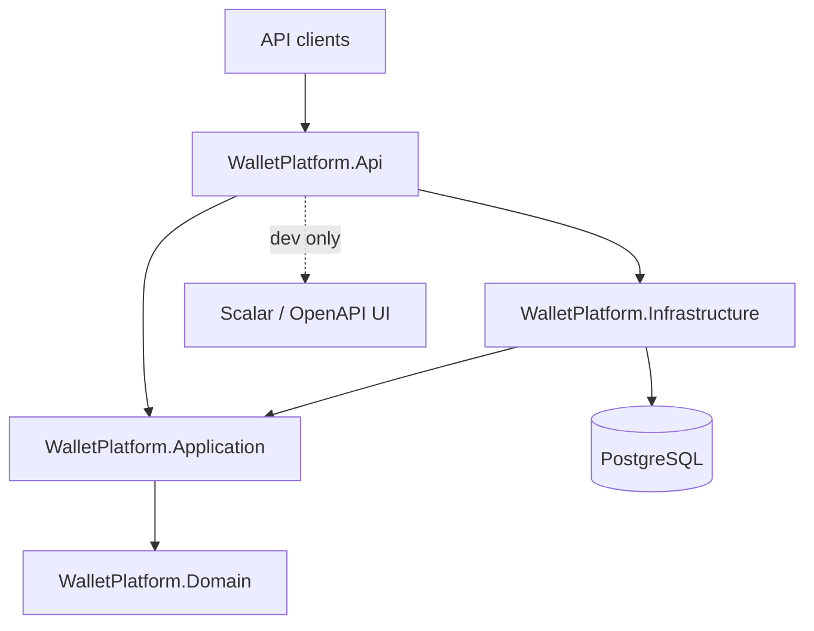

# PayPocket

A fintech-style digital wallet and bill-payment backend built with ASP.NET Core and PostgreSQL.

**Current status: Week 1 — foundation only.** No wallet or ledger business logic exists yet. What is in place is the skeleton every later feature will plug into: a layered solution, database wiring, structured logging, error handling, health checks, tests, and CI.

## Architecture



Dependencies point inward only. `Domain` has no dependencies at all, `Application` knows only `Domain`, `Infrastructure` implements `Application` ports, and `Api` is the composition root. The compiler enforces this through project references.

| Project | Responsibility |
| --- | --- |
| `src/WalletPlatform.Api` | Controllers, middleware, DI composition, `Program.cs` |
| `src/WalletPlatform.Application` | Use cases, interfaces, DTOs (empty in week 1) |
| `src/WalletPlatform.Domain` | Entities, value objects, business rules (empty in week 1) |
| `src/WalletPlatform.Infrastructure` | EF Core `WalletDbContext`, migrations, external adapters |
| `tests/WalletPlatform.UnitTests` | Fast, dependency-free tests |
| `tests/WalletPlatform.IntegrationTests` | API tests against a real Postgres in Docker |

## Tech stack

- .NET 10 (LTS) / ASP.NET Core controllers
- EF Core 10 + Npgsql (PostgreSQL 17)
- Serilog (console sink, request logging)
- xUnit, FluentAssertions 6.x, Testcontainers
- Docker Compose, GitHub Actions

## Prerequisites

- [.NET 10 SDK](https://dotnet.microsoft.com/download)
- [Docker Desktop](https://www.docker.com/products/docker-desktop/) (running)
- Optional: `psql` or any Postgres client to inspect the database

## Run locally

```bash
# 1. Create your environment file (never commit it)
cp .env.example .env          # Windows: Copy-Item .env.example .env

# 2. Start PostgreSQL (host port 5434 -> container 5432, see .env)
docker compose up -d
docker compose ps            # wait for STATUS = healthy

# 3. Restore local tools and packages
dotnet tool restore
dotnet restore

# 4. Apply database migrations
dotnet ef database update \
  --project src/WalletPlatform.Infrastructure \
  --startup-project src/WalletPlatform.Api

# 5. Run the API
dotnet run --project src/WalletPlatform.Api
```

The API listens on `http://localhost:5178` (from `Properties/launchSettings.json`).

| Endpoint | Purpose |
| --- | --- |
| `GET /api/ping` | App version and server time (UTC) |
| `GET /health/live` | Liveness — process is up, no dependencies checked |
| `GET /health/ready` | Readiness — verifies PostgreSQL connectivity |
| `GET /openapi/v1.json` | OpenAPI document (Development only) |
| `GET /scalar/v1` | Scalar API UI (Development only) |

> Port 5434 is the default host port because locally installed PostgreSQL services commonly occupy 5432/5433. Change `POSTGRES_PORT` in `.env` (and the connection string) if you prefer another port.

## Run tests

```bash
dotnet test
```

- Unit tests need nothing beyond the SDK.
- Integration tests use Testcontainers, which starts a disposable `postgres:17-alpine` container — Docker must be running. They do not use the compose database.

## Database migrations

```bash
# Add a migration
dotnet ef migrations add <Name> \
  --project src/WalletPlatform.Infrastructure \
  --startup-project src/WalletPlatform.Api

# Apply pending migrations
dotnet ef database update \
  --project src/WalletPlatform.Infrastructure \
  --startup-project src/WalletPlatform.Api
```

## Configuration

The development connection string lives in `src/WalletPlatform.Api/appsettings.Development.json`. Override it anywhere else via the standard ASP.NET Core environment variable:

```bash
ConnectionStrings__PayPocketDb="Host=...;Port=...;Database=...;Username=...;Password=..."
```

`.env` only feeds Docker Compose; the application never reads it directly.

## CI

`.github/workflows/ci.yml` runs on pushes and pull requests to `main`: restore, build (Release), test, then uploads `.trx` results as an artifact. Testcontainers works out of the box on the Ubuntu runner because Docker is preinstalled.

## Design decisions

See [docs/DECISIONS.md](docs/DECISIONS.md).
