# Entity relationship model

Phase 1 covers identity and authentication. Catalog, stock, purchasing and sales entities
arrive in later phases; this file grows with them.

## Diagram

```mermaid
erDiagram
    USERS ||--o{ USER_ROLES : "is assigned"
    ROLES ||--o{ USER_ROLES : "grants"
    ROLES ||--o{ ROLE_CLAIMS : "declares"
    USERS ||--o{ USER_CLAIMS : "asserts"
    USERS ||--o{ USER_LOGINS : "authenticates with"
    USERS ||--o{ USER_TOKENS : "owns"
    USERS ||--o{ REFRESH_TOKENS : "may hold"
    REFRESH_TOKENS ||--o{ REFRESH_TOKENS : "rotates into"

    USERS {
        uuid id PK
        varchar user_name UK
        varchar email
        varchar full_name
        bool is_active
        timestamptz created_at
        timestamptz last_login_at
        int access_failed_count
        timestamptz lockout_end
        xmin row_version "system column"
    }

    ROLES {
        uuid id PK
        varchar name UK
    }

    USER_ROLES {
        uuid user_id PK,FK
        uuid role_id PK,FK
    }

    ROLE_CLAIMS {
        int id PK
        uuid role_id FK
        text claim_type
        text claim_value
    }

    USER_CLAIMS {
        int id PK
        uuid user_id FK
        text claim_type
        text claim_value
    }

    USER_LOGINS {
        int id PK
        string login_provider
        string provider_key
        uuid user_id FK
    }

    USER_TOKENS {
        int id PK
        uuid user_id FK
        string name
        text value
        timestamptz expires_at
    }

    REFRESH_TOKENS {
        uuid id PK
        uuid user_id FK
        uuid family_id "rotation chain"
        text token_hash UK "SHA-256, never the raw token"
        timestamptz expires_at
        timestamptz created_at
        timestamptz revoked_at
        varchar revoked_reason
        text replaced_by_token_hash
    }
```

## Notes

**All keys are `uuid`.** Identity supports a custom key type, so user, role and token ids
are all `uuid`. Application entities introduced in later phases use the same type, which
lets `CreatedBy`, `ApprovedBy` and `PerformedBy` be plain `uuid` foreign keys.

**`users.row_version` is `xmin`, a PostgreSQL system column.** It is assigned by the
server on every update and does not appear in the `CREATE TABLE` statement. Mapping
`IHasRowVersion.RowVersion` onto it gives optimistic concurrency without a trigger or a
shadow column.

**`refresh_tokens.family_id` is not a foreign key to itself.** It is a denormalised chain
identifier: every token created by rotating one login shares a family id. Modelling it as
a self-referencing foreign key to the family's root token would add a lookup and a
constraint to express something that is already an invariant enforced in the domain.

**`refresh_tokens.token_hash` is unique** and is the lookup key. The raw token exists only
in the response that issued it, so a database disclosure yields nothing usable.

**There is no delete path from `users`.** Deleting a user would orphan every stock movement
and order they touched, destroying the history the audit trail exists to preserve.
Accounts are deactivated via `users.is_active` instead, which blocks new tokens while
keeping the record intact.

**`users` is not soft-deleted** either, for the same reason. Later phases introduce
`deleted_at` on catalog entities, where deletion is routine and history is preserved by a
`row_version` and audit trail rather than by keeping the row alive.